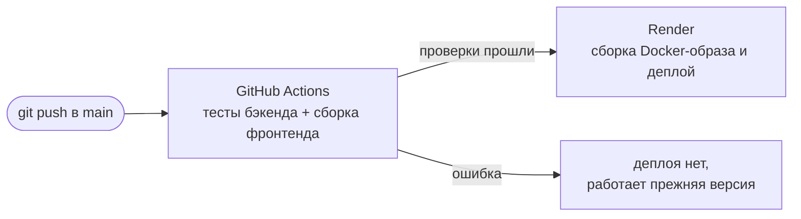

# CryptoPay Gateway

Облачная платёжная система для криптовалюты. Учебный проект по курсу
**Advanced Software Engineering**.

Продавец создаёт счёт через REST API. Покупатель оплачивает его через
кошелёк **MetaMask** в тестовой сети **Ethereum Sepolia**. Сервер проверяет
платёж в блокчейне, отслеживает подтверждения и уведомляет продавца
вебхуком с подписью HMAC. Система **non-custodial**: она не касается
приватных ключей, а деньги идут напрямую от покупателя продавцу.

- **Демо:** https://cryptopay-lw6t.onrender.com
- **Документация API (Swagger):** https://cryptopay-lw6t.onrender.com/docs
- **Пример реальной оплаты в Sepolia:** [0x6f9a…1006](https://sepolia.etherscan.io/tx/0x6f9adf40fafc6bff3a657912c85837bd55225cdc15b61cfa09a52b15c09b1006)

> Сервис на бесплатном тарифе Render: после 15 минут простоя первый запрос может идти 30–50 секунд.

## Документация

| № | Документ | Содержание |
|---|---|---|
| 1 | [Требования](docs/01-requirements.md) | Акторы, диаграмма вариантов использования, функциональные и нефункциональные требования |
| 2 | [Контекст и контейнеры](docs/02-context.md) | Диаграммы C4 (контекст и контейнеры), выбор технологий |
| 3 | [Диаграммы последовательности](docs/03-sequence.md) | Создание счёта, оплата через MetaMask, отслеживание подтверждений |
| 4 | [Диаграмма классов](docs/04-class.md) | Гексагональная архитектура: домен, порты, сервисы, адаптеры |
| 5 | [Диаграмма состояний](docs/05-state.md) | Жизненный цикл счёта |
| 6 | [SOLID](docs/06-solid.md) | Где применяется каждый принцип и какие паттерны использованы |

Все диаграммы написаны на Mermaid, и GitHub отрисовывает их автоматически.
В VS Code для этого нужно расширение *Markdown Preview Mermaid Support*.

## Структура проекта

```
backend/                сервис на FastAPI
  app/
    domain/             сущность Invoice + конечный автомат, доменные ошибки
    ports/              интерфейсы: BlockchainGateway, InvoiceRepository, PaymentNotifier
    services/           сценарии: InvoiceService, PaymentService, правила проверки
    adapters/           Ethereum JSON-RPC, репозиторий SQLAlchemy, вебхук и лог
    workers/            фоновый цикл PaymentWatcher
    api/                HTTP-маршруты, схемы, проверка API-ключа
    container.py        корень композиции (внедрение зависимостей)
    main.py             фабрика приложения; отдаёт и API, и собранный сайт
  tests/                модульные и API-тесты с заменителями (38 тестов)
frontend/               сайт на React (Vite): главная, кабинет, страница оплаты
docs/                   требования и UML-диаграммы
Dockerfile              сборка сайта и API в один контейнер
render.yaml             Blueprint для Render (веб-сервис + PostgreSQL)
.github/workflows/      CI: тесты и сборка при каждом push
```

## REST API

| Метод | Путь | Доступ | Описание |
|---|---|---|---|
| `GET` | `/health` | – | Проверка работоспособности |
| `GET` | `/api/config` | – | Сеть, chain id и адрес продавца |
| `POST` | `/api/invoices` | `X-API-Key`* | Создать счёт `{amount_eth, description, order_id?, ttl_minutes?}` |
| `GET` | `/api/invoices` | `X-API-Key`* | Список последних счетов |
| `GET` | `/api/invoices/{id}` | – | Публичные данные счёта (для страницы оплаты) |
| `POST` | `/api/invoices/{id}/transaction` | – | Передать хэш транзакции `{tx_hash}` |

\* Ключ нужен, только если на сервере задан `MERCHANT_API_KEY`. Если он пустой, работает **демо-режим**: счета можно создавать без ключа. Так удобнее показывать проект.

События вебхука: `invoice.paid`, `invoice.failed` и `invoice.expired`.
Заголовок `X-Signature` содержит `hex(HMAC_SHA256(WEBHOOK_SECRET, тело))`.

## Локальный запуск

Нужны Python 3.12+ и Node 20+.

```bash
# бэкенд
cd backend
python3 -m venv .venv
.venv/bin/pip install -r requirements.txt
cp .env.example .env          # укажите MERCHANT_ADDRESS (MERCHANT_API_KEY можно оставить пустым)
.venv/bin/uvicorn app.main:create_app --factory --reload
# → http://localhost:8000/docs
```

```bash
# фронтенд (во втором терминале)
cd frontend
npm install
npm run dev
# → http://localhost:5173
```

```bash
# тесты
cd backend && .venv/bin/python -m pytest -q
```

Если выполнить `npm run build` во `frontend`, бэкенд сам отдаёт собранный сайт
на http://localhost:8000. Так же он работает и на Render.

## Настройка кошелька (MetaMask + Sepolia)

1. Установите расширение [MetaMask](https://metamask.io/download/) (только с официального сайта) и создайте кошелёк **только для тестов**.
2. Нажмите на выбор сети → включите **Show test networks** → выберите **Sepolia** (не Linea/Unichain Sepolia).
3. Создайте два аккаунта (**Add account**): **Магазин** (его адрес нужно указать в `MERCHANT_ADDRESS`) и **Покупатель**.
4. Получите бесплатные Sepolia ETH на адрес покупателя через faucet, например Google Cloud Web3 Faucet.
5. Никому не передавайте seed-фразу и приватный ключ. Шлюзу нужен только публичный адрес продавца.

## Деплой на Render

1. **GitHub.** Загрузите репозиторий. Он может быть приватным: Render умеет деплоить приватные репозитории.
2. **Render → New → Blueprint.** Выберите репозиторий, и Render прочитает `render.yaml`. Он создаст:
   - веб-сервис `cryptopay` (Docker: сайт + API);
   - бесплатную базу PostgreSQL `cryptopay-db`. Строка подключения подставится в `DATABASE_URL` автоматически.
3. Во время создания укажите `MERCHANT_ADDRESS` (публичный адрес из MetaMask) и, если нужно, `WEBHOOK_URL`.
4. `MERCHANT_API_KEY` оставьте пустым для демо-режима (кнопка «Попробовать оплату» на главной работает без ключа) или задайте пароль, чтобы закрыть кабинет.
5. Сайт будет доступен по адресу вида `https://cryptopay-xxxx.onrender.com`, Swagger — по адресу `/docs`.
6. Необязательно: чтобы бесплатный сервис не засыпал, настройте UptimeRobot на запрос `https://…onrender.com/health` каждые 10 минут.

> Бесплатная база PostgreSQL на Render работает 30 дней. Для защиты проекта этого хватает, а потом базу можно пересоздать в один клик.

## CI/CD



- **CI** (`.github/workflows/ci.yml`): при каждом push и pull request запускаются тесты (`pytest`) и сборка React.
- **CD** (`render.yaml`, `autoDeployTrigger: checksPass`): Render автоматически деплоит ветку `main`, но только после успешного CI.

## Сценарий демонстрации

1. На главной нажмите **Попробовать оплату**. Или откройте **Кабинет**, создайте счёт на 0.001 ETH и нажмите **Перейти к оплате**.
2. Нажмите **Подключить MetaMask**, затем **Оплатить** и подтвердите транзакцию в MetaMask.
3. Следите за статусом: *Ожидает оплаты → Подтверждается (1 из 2, 2 из 2) → Оплачен*.
4. Покажите транзакцию в Sepolia Etherscan (кнопка на странице после оплаты) и, если он настроен, вебхук на webhook.site.
5. Граничные случаи: дайте счёту истечь или попробуйте использовать тот же хэш транзакции для второго счёта (ответ 409).
