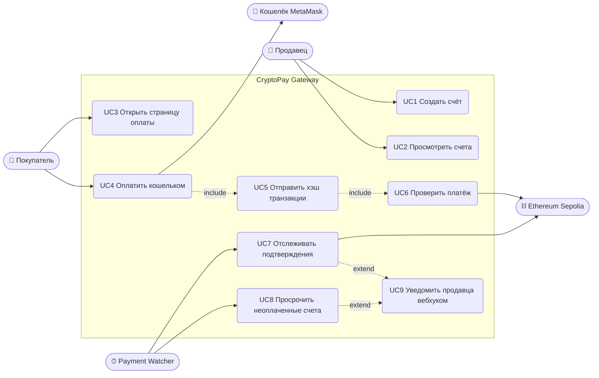

# 1. Требования

## 1.1 Постановка задачи

Интернет-магазины хотят принимать криптовалюту, но работать с блокчейном
напрямую сложно: нужно следить за сетью, сопоставлять входящие переводы с
заказами, ждать подтверждений и защищаться от поддельных или повторно
использованных платежей.

**CryptoPay Gateway** — облачная платёжная система, которая скрывает эту
сложность. Магазин создаёт *счёт* (invoice) через REST API. Клиент оплачивает
его из браузерного кошелька **MetaMask** (интеграция через открытые стандарты
EIP-1193 и EIP-6963). Шлюз проверяет платёж в тестовой сети
**Ethereum Sepolia** и уведомляет магазин подписанным вебхуком.

## 1.2 Акторы

| Актор | Описание |
|---|---|
| **Продавец (Merchant)** | Владелец магазина. Создаёт счета и следит за оплатами через кабинет или REST API с API-ключом. |
| **Покупатель (Customer)** | Оплачивает счёт из браузерного кошелька. Аккаунт не нужен: кошелёк и есть его идентификатор. |
| **Кошелёк (MetaMask)** | Браузерное расширение-кошелёк. Хранит приватный ключ покупателя и подписывает транзакцию. |
| **Сеть Ethereum (Sepolia)** | Публичный блокчейн, доступный через JSON-RPC провайдера. Источник истины о платежах. |
| **Бэкенд магазина** | Система, которая принимает вебхуки `invoice.paid`, `invoice.failed` и `invoice.expired`. В проекте её роль играет встроенный демо-магазин «Кофейня». |
| **Telegram** | Мессенджер, куда бот присылает продавцу уведомления о платежах (необязательно). |
| **Планировщик (Payment Watcher)** | Внутренний фоновый процесс. Периодически проверяет подтверждения и истечение сроков счетов. |

## 1.3 Варианты использования (Use Case)

## 1.4 Функциональные требования

| ID | Требование |
|---|---|
| **FR-1** | Продавец может создать счёт: сумма в ETH, описание, необязательный номер заказа и срок действия (TTL, по умолчанию 15 минут). |
| **FR-2** | Создание и просмотр списка счетов можно защитить API-ключом продавца (заголовок `X-API-Key`). Так как проект учебный, проверку ключа включает и выключает переключатель в кабинете, а сам ключ показан там же. По умолчанию проверка выключена. |
| **FR-3** | У каждого счёта есть публичная страница оплаты по его id. На ней видны сумма, адрес получателя, сеть, обратный отсчёт и текущий статус. |
| **FR-4** | Покупатель может подключить MetaMask. Если MetaMask в другой сети, страница просит переключиться на Sepolia (и добавляет её, если сети нет). Если MetaMask не установлен, страница предлагает его установить. |
| **FR-5** | Покупатель оплачивает счёт одним нажатием: кошелёк подписывает и отправляет транзакцию, а страница передаёт её хэш на сервер. |
| **FR-6** | Сервер проверяет транзакцию в блокчейне: верный получатель, верная сеть (chain id), сумма не меньше суммы счёта. Неверные транзакции отклоняются с понятной причиной. |
| **FR-7** | Один хэш транзакции можно использовать только для одного счёта (защита от повторного использования платежа). |
| **FR-8** | Сервер отслеживает подтверждения. Счёт становится **PAID**, когда транзакция успешно попала в блок и набрала не менее *N* подтверждений (настраивается, по умолчанию 2). |
| **FR-9** | Счёт, не оплаченный в течение TTL, становится **EXPIRED**. Если транзакция попала в блок с ошибкой (reverted) или так и не появилась в сети, счёт становится **FAILED**. |
| **FR-10** | При каждом финальном статусе (PAID, FAILED, EXPIRED) продавец получает вебхук с подписью HMAC (если он настроен), а событие записывается в лог. |
| **FR-11** | Страница оплаты обновляет статус автоматически (опросом сервера) и даёт ссылку на транзакцию в обозревателе блоков. |
| **FR-12** | В кабинете продавца есть список счетов со статусами и форма создания нового счёта. После создания счёта есть кнопки «Перейти к оплате» и «Копировать ссылку». |
| **FR-13** | На главной странице объяснено, что делать продавцу и покупателю. Есть инструкция по подготовке MetaMask, блок «Состояние системы» и кнопка «Попробовать оплату», которая создаёт демо-счёт и открывает страницу оплаты. |
| **FR-14** | На каждой странице есть навигация назад или на главную. После оплаты, истечения срока или ошибки страница предлагает следующее действие: посмотреть транзакцию, создать новый счёт, вернуться на главную. |
| **FR-15** | Все ошибки, включая ошибки проверки введённых данных и ошибки MetaMask (отказ, нехватка средств), показываются на русском языке с понятной причиной. |
| **FR-16** | На странице оплаты показывается **хронология платежа**: каждое событие (счёт создан, транзакция получена и проверена, подтверждения, оплачен, вебхук доставлен, Telegram отправлен) с точным временем. Хронология хранится в базе (`invoice_events`) и доступна по `GET /api/invoices/{id}/events`. |
| **FR-17** | Если настроен Telegram-бот (`TELEGRAM_BOT_TOKEN`, `TELEGRAM_CHAT_ID`), продавец получает сообщение об оплате, ошибке или истечении счёта. |
| **FR-18** | В системе есть **демо-магазин «Кофейня»** — пример клиента шлюза: покупатель собирает корзину, магазин создаёт счёт, покупатель платит, а заказ становится «Оплачен» только после получения вебхука с верной подписью HMAC. |

## 1.5 Нефункциональные требования

| ID | Категория | Требование |
|---|---|---|
| **NFR-1** | Безопасность | Шлюз никогда не хранит и не обрабатывает приватные ключи, он только *читает* блокчейн. Деньги идут напрямую от покупателя продавцу (non-custodial). |
| **NFR-2** | Безопасность | Секреты (API-ключ, секрет вебхука, RPC URL) передаются через переменные окружения и не попадают в репозиторий. Вебхуки подписываются HMAC-SHA256. Проверка API-ключа включается переключателем (или переменной `API_KEY_REQUIRED`). В настоящем магазине переключателя не было бы, а ключ хранился бы только у продавца. |
| **NFR-3** | Надёжность | Статус платежа определяется по блокчейну, а не по данным клиента. Фронтенд сообщает только хэш транзакции, сервер всё перепроверяет сам. |
| **NFR-4** | Доступность | Система развёрнута в облаке Render: один веб-сервис (сайт и API в Docker-контейнере) и управляемая база PostgreSQL. |
| **NFR-5** | Сопровождаемость | Простая структура: 9 файлов, у каждого одна задача. Бизнес-логика (`payments.py`) зависит только от интерфейсов, конкретные классы выбираются в одном месте (`main.py`). |
| **NFR-6** | Переносимость | База данных задаётся строкой подключения: SQLite при локальной разработке, PostgreSQL в облаке. |
| **NFR-7** | Тестируемость | Основные сервисы покрыты модульными тестами с in-memory заменами блокчейна и репозитория. |
| **NFR-8** | Удобство | Минималистичный адаптивный интерфейс на русском языке. Оплата занимает не больше трёх нажатий: «Подключить MetaMask», «Оплатить», «Подтвердить в MetaMask». |
| **NFR-9** | Производительность | Ответ API (без учёта обращений к блокчейну) быстрее 300 мс. Статус обновляется не реже чем раз в 10 секунд. |
| **NFR-10** | Документация | REST API самодокументируется через OpenAPI / Swagger (`/docs`). |

## 1.6 Вне рамок проекта

- Возвраты и выплаты: для них серверу пришлось бы хранить приватный ключ (custodial-кошелёк).
- Несколько продавцов и их регистрация: один продавец на развёртывание, задаётся переменными окружения.
- Токены ERC-20 и основная сеть (mainnet): только нативный ETH в Sepolia.
- Конвертация в фиат и курсы валют.
