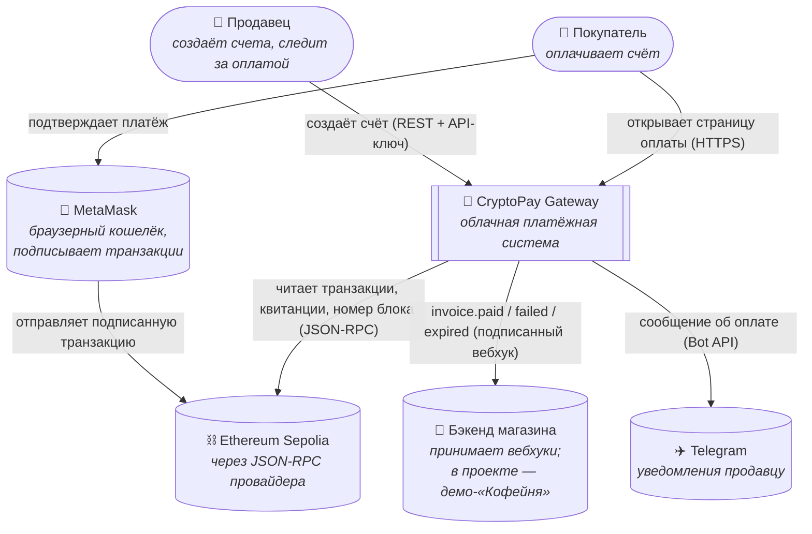
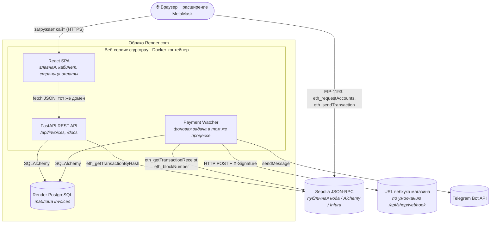

# 2. Контекстная диаграмма и диаграмма контейнеров

## 2.1 Контекст системы (C4, уровень 1)

Система показана как «чёрный ящик» вместе со всем, с чем она взаимодействует.

## 2.2 Контейнеры (C4, уровень 2)

Показывает, из каких развёртываемых частей состоит система и где они работают в облаке.

Сайт и API отдаются **одним сервисом с одного домена**. Поэтому не нужна
настройка CORS и отдельный хостинг для фронтенда. Docker-образ собирается в
два этапа: Node собирает React, затем Python-образ получает готовые файлы.

## 2.3 Выбор технологий

| Задача | Выбор | Почему |
|---|---|---|
| Бэкенд | Python 3.12, FastAPI, SQLAlchemy 2, httpx | Быстрая разработка, OpenAPI из коробки, типизация. |
| Фронтенд | React + Vite, прямые вызовы EIP-1193 | Без SDK: MetaMask находится через EIP-6963 и вызывается через стандартный API провайдера EIP-1193. |
| Кошелёк | MetaMask | Самый распространённый браузерный кошелёк, исходный код открыт на GitHub, тестовая сеть Sepolia включается одним переключателем. |
| Блокчейн | Ethereum Sepolia | Бесплатные тестовые ETH с faucet, блок примерно каждые 12 секунд. |
| База данных | SQLite (локально) / PostgreSQL (облако) | Выбирается через `DATABASE_URL`, код не меняется. |
| Хостинг | Render: веб-сервис на Docker + PostgreSQL | Бесплатный тариф, деплой из GitHub по `render.yaml` в один клик. |
