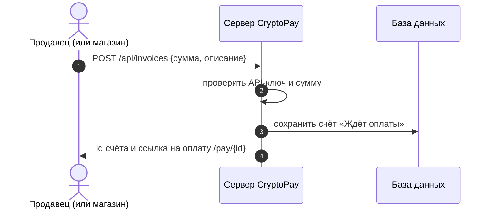
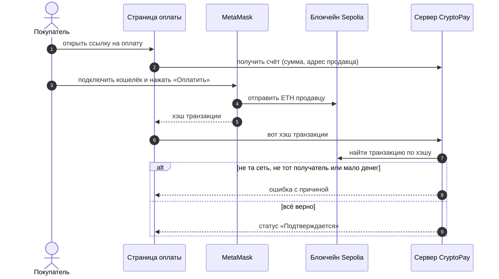
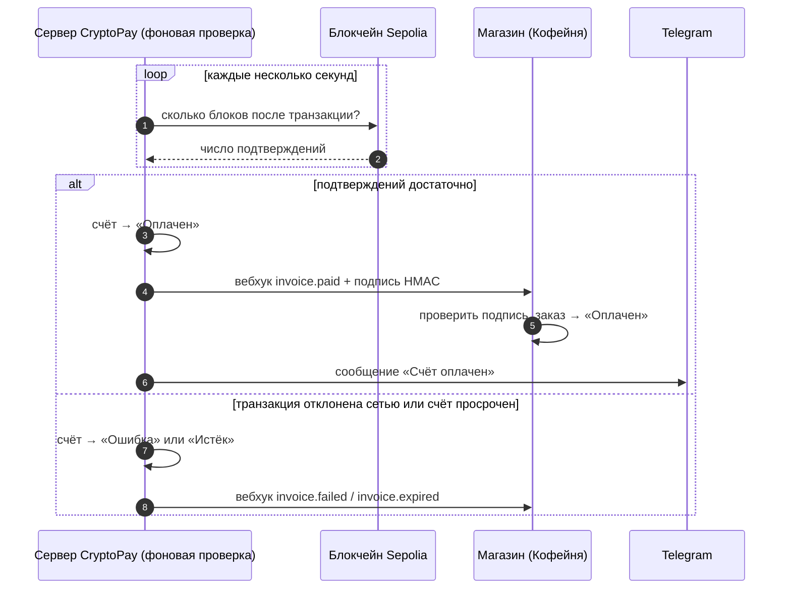

# 3. Диаграммы последовательности

Три главных сценария: продавец создаёт счёт, покупатель платит, сервер ждёт
подтверждений и сообщает магазину. Внутренние классы сервера здесь не показаны,
они есть на диаграмме классов (`04-class.md`).

## 3.1 Создание счёта

## 3.2 Оплата через MetaMask

## 3.3 Подтверждение и уведомления

Сервер сам, без участия покупателя, проверяет транзакцию каждые несколько секунд.

