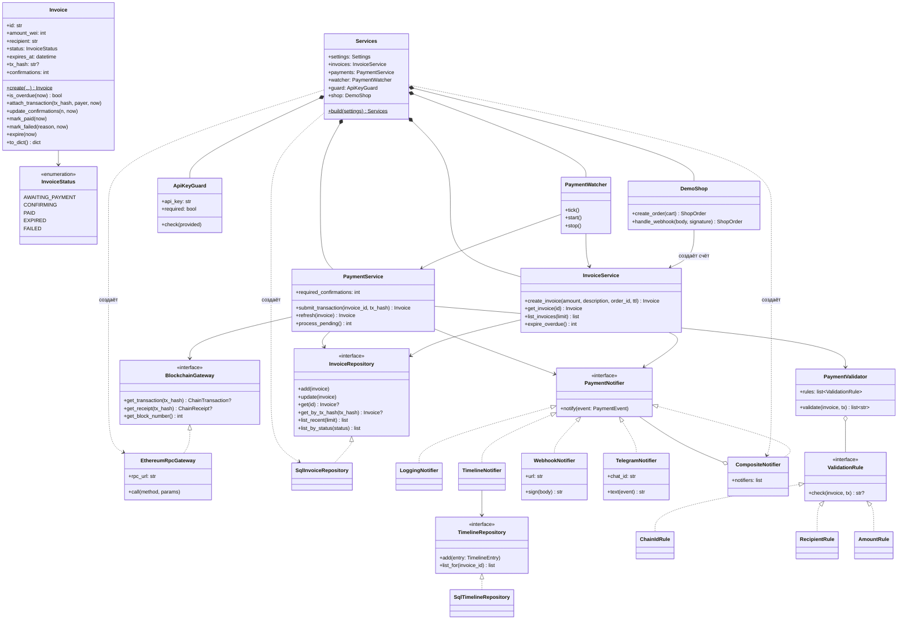
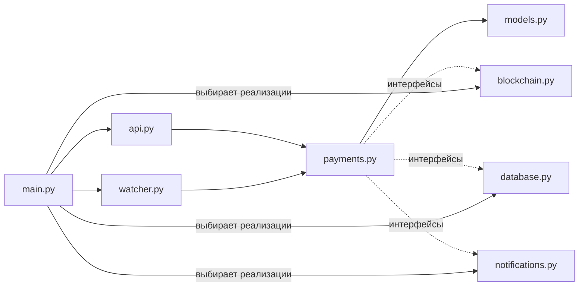

# 4. Диаграмма классов

Бэкенд — это 10 файлов в одной папке `backend/app/`. Каждый файл отвечает за одну часть системы:

| Файл | Что внутри |
|---|---|
| `models.py` | Счёт `Invoice`, его статусы (конечный автомат) и бизнес-ошибки |
| `blockchain.py` | Интерфейс `BlockchainGateway` и реализация `EthereumRpcGateway` (JSON-RPC) |
| `database.py` | Интерфейсы `InvoiceRepository`, `TimelineRepository` и их реализации на SQLAlchemy |
| `notifications.py` | Интерфейс `PaymentNotifier`: лог, хронология, вебхук, Telegram, рассылка нескольким |
| `payments.py` | Бизнес-логика: правила проверки, `InvoiceService`, `PaymentService` |
| `watcher.py` | Фоновый процесс `PaymentWatcher` |
| `api.py` | REST API: схемы, маршруты, проверка API-ключа `ApiKeyGuard` |
| `main.py` | Сборка всех частей (`Services.build`) и запуск FastAPI |
| `config.py` | Настройки из переменных окружения |
| `shop.py` | Демо-магазин «Кофейня» `DemoShop` — пример клиента шлюза |

Тестовые заменители (`FakeBlockchain`, `InMemoryInvoiceRepository` и
`RecordingNotifier` в `backend/tests/fakes.py`) реализуют те же интерфейсы. Поэтому
сервисы можно тестировать без сети и без базы данных (принцип подстановки Лисков).

## Кто от кого зависит

`payments.py` работает только с интерфейсами (`BlockchainGateway`,
`InvoiceRepository`, `PaymentNotifier`). Конкретные классы выбираются в одном
месте: `Services.build()` в `main.py`.
