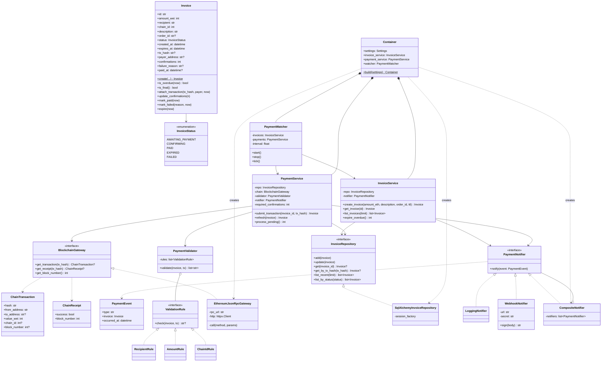
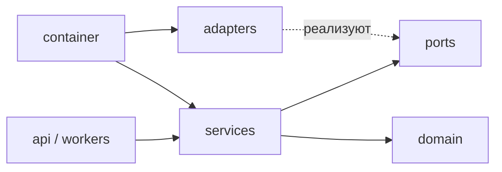

# 4. Диаграмма классов

Бэкенд построен по **гексагональной архитектуре (порты и адаптеры)**:

- **domain** — чистые бизнес-объекты, без фреймворков;
- **ports** — абстрактные интерфейсы, которые нужны ядру (`BlockchainGateway`, `InvoiceRepository`, `PaymentNotifier`);
- **services** — сценарии использования, зависят только от портов;
- **adapters** — конкретная инфраструктура (JSON-RPC, SQLAlchemy, вебхуки);
- **api / workers** — точки входа (HTTP и фоновый цикл);
- **container** — корень композиции: подставляет адаптеры в сервисы (внедрение зависимостей).

Тестовые заменители (`FakeBlockchain`, `InMemoryInvoiceRepository` и
`RecordingNotifier` в `backend/tests/fakes.py`) реализуют те же порты. Поэтому
сервисы можно тестировать без сети и без базы данных (принцип подстановки Лисков).

## Слои и направление зависимостей

Все стрелки направлены **внутрь**, к домену. Ядро ничего не знает о FastAPI,
SQLAlchemy или Ethereum JSON-RPC.
