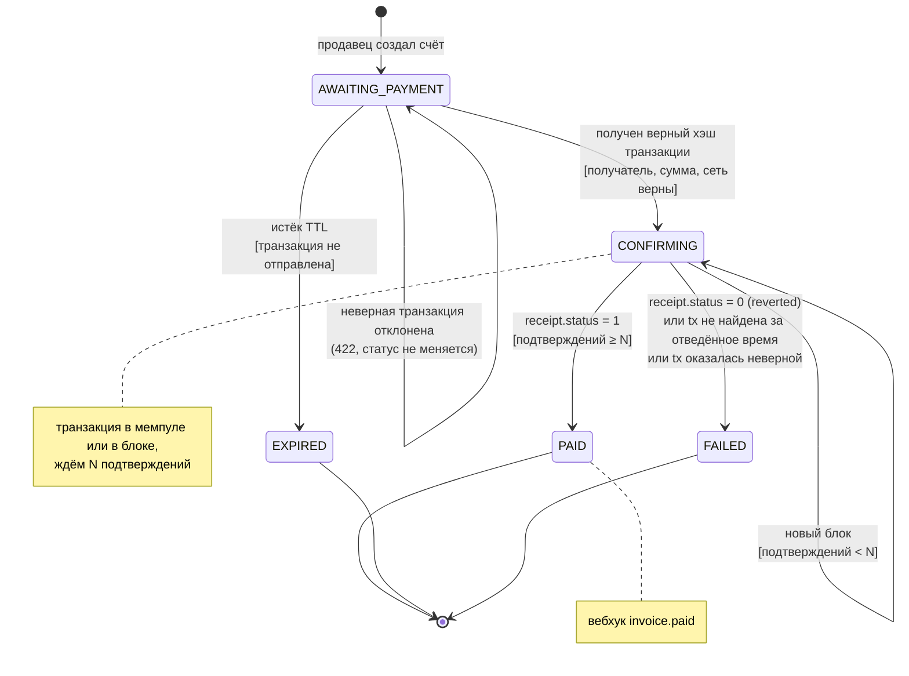

# 5. Диаграмма состояний: жизненный цикл счёта

Сущность `Invoice` сама следит за допустимыми переходами (см.
`backend/app/models.py`). Любой другой переход выбрасывает
`InvalidStateTransition`.

| Статус | Значение | Финальный? | Вебхук |
|---|---|---|---|
| `AWAITING_PAYMENT` | Счёт создан, ждём покупателя. | нет | — |
| `CONFIRMING` | Транзакция принята, ждём подтверждений. | нет | — |
| `PAID` | Платёж подтверждён в блокчейне. | да | `invoice.paid` |
| `EXPIRED` | Не оплачен в течение срока действия. | да | `invoice.expired` |
| `FAILED` | Транзакция отклонена сетью, пропала или оказалась неверной. | да | `invoice.failed` |
