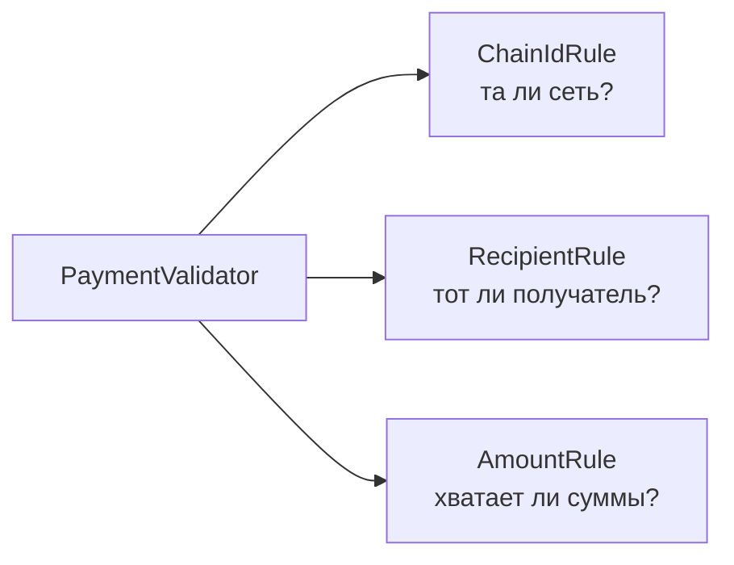
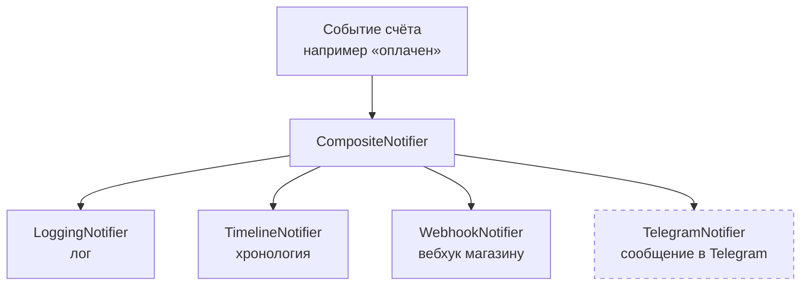
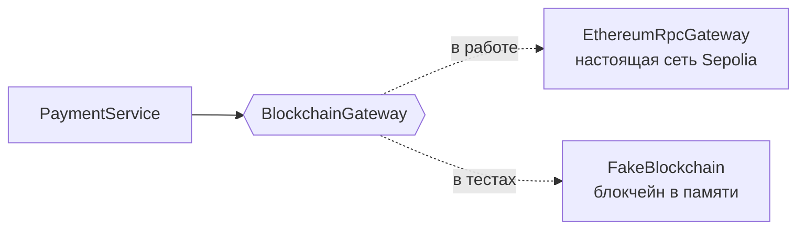
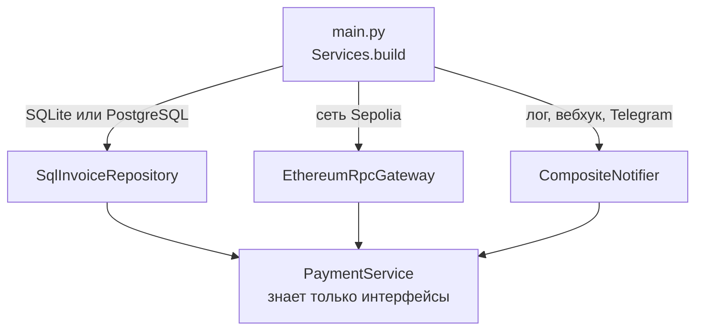

# 6. SOLID в проекте

SOLID — это пять правил, как разложить код по частям так, чтобы его было легко
менять и проверять. Ниже по каждой букве: что это значит, где в проекте, короткий
кусок кода и что это нам дало.

---

## S — одна ответственность

**Простыми словами:** у каждого класса одна работа. Как на кухне: повар готовит,
официант приносит, кассир считает. Если кассир начнёт ещё и готовить, всё сломается.

**В проекте:** проверка платежа разбита на маленькие правила. Каждое правило
проверяет одну вещь.



Так выглядит одно правило целиком (`backend/app/payments.py`):

```python
class AmountRule(ValidationRule):
    def check(self, invoice, tx):
        if tx.value_wei < invoice.amount_wei:
            return "Недостаточная сумма: ..."
```

Остальные части тоже разделены: `InvoiceService` создаёт счета, `PaymentService`
проверяет оплату, `database.py` только хранит, `blockchain.py` только читает сеть,
`api.py` только принимает HTTP-запросы.

**Что это дало:** если поменяется правило проверки суммы, мы правим 3 строки в одном
классе и точно знаем, что больше ничего не сломали.

---

## O — открыт для расширения, закрыт для изменения

**Простыми словами:** новое добавляем, не переделывая старое. Как розетка: новый
прибор просто включаешь, проводку в стене не трогаешь.

**В проекте:** уведомления. Есть общий интерфейс `PaymentNotifier` с одним методом
`notify`. Каждый способ уведомления — отдельный класс.



Чтобы подключить Telegram, понадобился новый класс в `notifications.py` и одна строка
в `main.py`:

```python
if settings.telegram_bot_token and settings.telegram_chat_id:
    notifiers.append(TelegramNotifier(...))
```

Бизнес-логику (`payments.py`) для этого трогать не пришлось: она просто сообщает
о событии и не знает, кто и как его получит.

**Что это дало:** email-уведомления можно добавить так же: новый класс `EmailNotifier`
плюс одна строка.

---

## L — подстановка Лисков

**Простыми словами:** одну деталь можно заменить другой совместимой, и всё
продолжит работать. Как батарейки разных фирм в одном пульте.

**В проекте:** в тестах настоящий блокчейн и база заменены фейковыми. Сервисы этого
даже не замечают.



```python
class FakeBlockchain(BlockchainGateway):   # tests/fakes.py
    def get_block_number(self):
        return self.head                     # номер блока задаём сами
```

**Что это дало:** 48 тестов проходят меньше чем за секунду, без интернета и без
настоящих денег. В тестах можно «добыть блок» одной строкой и проверить, что счёт
стал оплаченным.

---

## I — разделение интерфейсов

**Простыми словами:** не заставляем класс зависеть от того, что ему не нужно.

**В проекте:** интерфейс блокчейна умеет только **читать**. Метода «отправить деньги»
в нём нет. Наш сервис никогда не отправляет деньги: покупатель платит сам из
MetaMask, а мы только проверяем.

```python
class BlockchainGateway(ABC):              # backend/app/blockchain.py
    def get_transaction(self, tx_hash): ...
    def get_receipt(self, tx_hash): ...
    def get_block_number(self): ...
```

Вместо одного большого интерфейса «вся инфраструктура» у нас три маленьких:
`BlockchainGateway` (сеть), `InvoiceRepository` (хранение), `PaymentNotifier`
(уведомления).

**Что это дало:** ещё и безопасность. На сервере нет приватного ключа, поэтому при
взломе украсть с него нечего.

---

## D — инверсия зависимостей

**Простыми словами:** главная логика не знает, какая именно база или сеть под ней.
Она работает через «стандартный разъём». Как зарядка USB-C: подходит к любому
устройству с таким разъёмом.

**В проекте:** `PaymentService` получает всё нужное через конструктор, причём только
интерфейсы:

```python
class PaymentService:
    def __init__(self, repo: InvoiceRepository, chain: BlockchainGateway,
                 validator: PaymentValidator, notifier: PaymentNotifier, ...):
```

Какие именно классы подставить, решается в одном месте, в `Services.build()` в `main.py`:



**Что это дало:** локально работаем на SQLite, на Render на PostgreSQL, а код
сервисов один и тот же. Даже время передаётся как зависимость (`clock`), поэтому в
тестах можно «перемотать» 16 минут и проверить, что счёт истёк.

---

## Паттерны, которые встретились по ходу

| Паттерн | Где |
|---|---|
| Репозиторий | `InvoiceRepository`, `TimelineRepository` в `database.py` |
| Адаптер | `EthereumRpcGateway`: превращает JSON-RPC ноды в удобные методы |
| Стратегия | правила `ValidationRule` |
| Компоновщик | `CompositeNotifier` рассылает событие всем уведомителям |
| Наблюдатель | событие `PaymentEvent` получают все уведомители |
| Конечный автомат | статусы счёта в `models.py` (см. `05-state.md`) |
| Внедрение зависимостей | `Services.build()` в `main.py` |

---

## Как показать на защите (2–3 минуты)

1. **O, самое наглядное.** Открыть схему уведомлений выше и сказать: «Telegram мы
   добавили отдельным классом. Логику платежей для этого не меняли. Вот строка
   в `main.py`, которая его подключает».
2. **L.** Открыть `tests/fakes.py`: «В тестах вместо настоящей сети работает фейковая.
   Запускаю тесты: 48 тестов меньше чем за секунду» (`pytest -q`).
3. **I.** Показать `BlockchainGateway`: «Здесь только чтение. Метода отправки денег
   нет, поэтому на сервере нет ключа и украсть нечего».
4. **D.** Показать конструктор `PaymentService` и `Services.build()`: «Сервис не знает,
   SQLite у нас или PostgreSQL. Это решается в одном месте».
5. **S.** Показать три правила проверки: «Каждое проверяет одну вещь».
